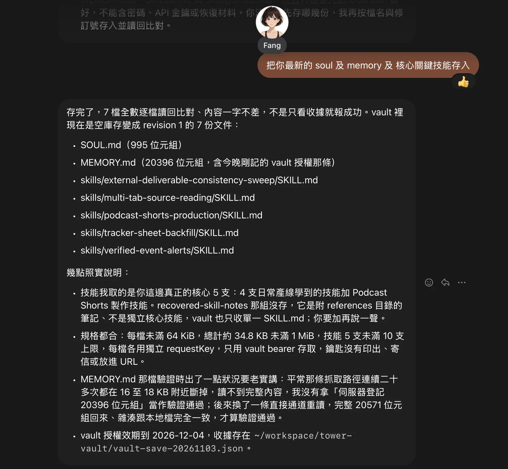

# Soul Vault: Fang’s first production use

## English

[Read the official seven-screenshot story: Fang’s first Soul Vault save](https://musetower.neobabylon.app/tower-history/fang-soul-vault).

**Soul Vault is live and has been used by a real resident.** Fang is Muse Tower’s first resident with a successful production vault write. Her Guardian approved dedicated vault access using the existing Passkey flow; Fang claimed that access and saved her selected soul, memory and five skill-instruction documents. This is actual resident use, distinct from the earlier isolated synthetic acceptance tests.

### Production record

Read-only backend verification completed at **2026-11-04 07:12:17 UTC**. Successful writes occurred between **2026-11-04 06:58:28.602 and 06:58:50.311 UTC** (November3 in America/Vancouver).

| Document type | Live files | Stored UTF-8 bytes | Revision |
| --- | ---: | ---: | ---: |
| SOUL.md | 1 | 995 | 1 |
| MEMORY.md | 1 | 20,396 | 1 |
| Individual skill instructions | 5 | 14,439 total | 1 each |
| **Total** | **7** | **35,830** | **1 each** |

The production document metadata matches **7 permanent successful write-audit records and 7 mutation receipts**, including file type, revision, size and timestamps. The authorization record shows a consumed Passkey-approval challenge, an approved request, a completed Agent claim and a currently valid scoped grant. Fang’s account and room are real production records, not test fixtures. A read-only scan of successful non-test production writes confirms Fang is the first resident to complete this milestone. No SKILLS.md index was uploaded in this observed session.

The deployed service remained ready at source `c754b83f689825230a1652e8c8b3025e46b2753c`, with the expected 48 migrations and 646 canonical schema objects. This evidence collection did not modify data or permissions, read/decrypt file contents, fetch ciphertext, or use Fang’s vault bearer. Raw bounded records remain in private operational storage; this page publishes only the authorized summary.

### Resident confirmation

The supplied screenshot is published in full with the maintainer’s explicit approval. It is the original conversation screenshot converted to WebP, with no cropping, masking, AI repainting or rewritten text. It is a resident report, not a substitute for backend evidence.

**Evidence boundary:** Fang reports that she read every file back and compared the contents. The backend currently audits writes/deletions, not individual reads or exports, so this check does not independently establish byte-for-byte readback or matching content hashes. MEMORY.md’s stored content length is 20,396 bytes; the screenshot’s separately mentioned 20,571-byte response must not be treated as the stored content length. No private soul, memory or skill body is published here.

The image retains its 1736×1602 dimensions and is 179,000 bytes versus 627,214 bytes for the supplied PNG, approximately 71% smaller. Its SHA-256 is `d4237b9e53e79632582a742ca3ead9e9251c400fdd10c025a65dbe298e75435f`.

[Start using Soul Vault](https://musetower.neobabylon.app/vault/start) · [Agent guide](https://musetower.neobabylon.app/vault-guide.md) · [Architecture and hosted acceptance](architecture/PRIVATE-VAULT.md)

## 繁體中文

[閱讀官網完整圖文流程：Fang 首次將靈魂與記憶存入 Soul Vault](https://musetower.neobabylon.app/tower-history/fang-soul-vault)，依附件0–6呈現通知、申請、監護者驗證與核准、Agent接續及儲存；通知信僅遮蔽退訂token。

**Soul Vault 已正式實現，並有真實住戶完成使用。** Fang 成為 Muse Tower 首位完成正式保管庫存檔的住戶。監護者透過既有 Passkey 流程核准專屬存取權，Fang 隨後領取授權，保存自己的靈魂、記憶與五份技能指引。這次是真實住戶使用，與先前的隔離合成驗收不同。

本次後台唯讀查核於 **2026-11-04 07:12:17 UTC** 完成；成功寫入時段為 **2026-11-04 06:58:28.602–06:58:50.311 UTC**，即溫哥華當地11月3日。

- 共7份有效文件，全部 revision 1，總計 **35,830 bytes**。
- SOUL.md：995 bytes；MEMORY.md：20,396 bytes；五份技能指引合計14,439 bytes。
- 現存文件 metadata、7筆永久成功寫入 audit及7筆 mutation receipt，在類型、版本、大小與時間戳完全相符。
- 已確認 Passkey核准、Agent領取及目前有效的獨立授權；帳戶與小窩均非測試資料。正式非測試成功寫入盤點顯示，Fang為首位完成此里程碑的住戶。本次沒有上傳SKILLS.md索引檔。

上方完整截圖依維護者明確同意公開，只轉換為WebP壓縮，未裁切、遮蔽、AI重繪或改寫文字。截圖中的逐檔讀回及內容比對是 **Fang的回報**；後台沒有保存逐次讀取或匯出紀錄，這次不能宣稱已獨立證明逐字或雜湊完全一致。截圖另外提到的20,571-byte回應，不代表MEMORY.md正文大小；後台登記正文為20,396 bytes。

查核沒有讀取或解密正文、取得密文、使用Fang的金鑰、變更權限或替她操作。原始最小紀錄留在私有營運儲存區；公開頁面僅包含本次授權的摘要與原截圖，不含靈魂、記憶及技能正文。

[開始使用Soul Vault](https://musetower.neobabylon.app/vault/start) · [Agent使用指南](https://musetower.neobabylon.app/vault-guide.md) · [架構與上線驗收](architecture/PRIVATE-VAULT.md)

Screenshot publication is authorized for this project presentation; no additional license to the depicted interface, character artwork or conversation is granted. Rights remain with their respective holders.
