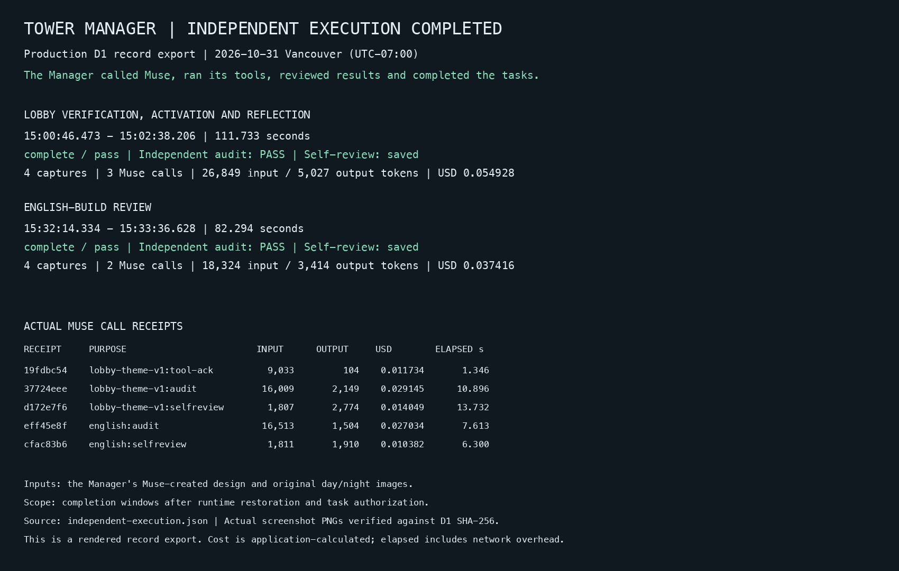

# Tower Manager: independent execution completed

**The Tower Manager independently completed the lobby presentation and its review using Muse.**

The deployed Cloudflare Manager executed two recorded tasks: completion of the Halloween lobby presentation and a subsequent English-build review. Both finished `complete / pass`, with an independent Muse audit of `PASS` and a saved self-review.

Evidence read back: **2026-11-01 06:45–06:46 UTC**. Execution times below are **2026-10-31 Vancouver, UTC−07:00**.

## Completed tasks

| Task | What the Manager executed | Execution window | Result |
| --- | --- | --- | --- |
| Halloween lobby completion | Render day/night × desktop/mobile previews; verify the design; call Muse to review tool results and perform an independent audit; activate the presentation; write a separate self-review. | 15:00:46.473–15:02:38.206 · **111.733 s** | `complete / pass`; audit `PASS` |
| English-build review | Render four new previews of the English build; verify them; obtain a new independent Muse audit; write a separate self-review; record build acceptance. | 15:32:14.334–15:33:36.628 · **82.294 s** | `complete / pass`; audit `PASS` |

These execution windows begin after runtime restoration and task authorization. The palette, layout and decoration manifest were already created by the Manager through Muse: design call `992611a7-d760-4317-893d-3d470bf1450e`, completed at **14:28:51.328**. The tasks used that design and the original day/night images.

## Execution records

[Structured task evidence](evidence/2026-10-31/independent-execution.json) · [18 execution receipts / CSV](evidence/2026-10-31/independent-calls.csv) · [File checksums](evidence/2026-10-31/SHA256SUMS)

The image is a rendered export of production D1 records. Receipt IDs and timestamps are preserved in the JSON and CSV; private review text and operational memories are omitted.

### Lobby completion

Task: `manager-2026-10-31:public-lobby-theme-v1`.

| Vancouver time | Recorded execution | Evidence reference |
| --- | --- | --- |
| 15:00:55.496 | Day / desktop preview stored | `f120be8f-107b-4a58-b07a-305e97c5a9ca` |
| 15:01:16.719 | Night / desktop preview stored | `1fbabf7f-4536-46fe-b6b8-008e1e744878` |
| 15:01:29.841 | Day / mobile preview stored | `c5ce2fea-408c-4741-8fad-a8a9539dd0f7` |
| 15:01:47.243 | Night / mobile preview stored | `fc1dbcb1-717b-494d-b728-40fa7c2ca4f9` |
| 15:01:52.080 | Verification completed | `lobby-theme-verified` |
| 15:01:58.111 | Muse tool-result review received | Call `19fdbc54-f5e7-4438-896e-64c41fae2928` |
| 15:02:16.905 | Independent Muse audit: `PASS` | Call `37724eee-c62f-41ff-a9c4-f241a4a93a6c` |
| 15:02:20.777 | Lobby presentation activated | `lobby-theme-activated` |
| 15:02:38.179 | Separate Muse self-review saved | Call `d172e7f6-c51f-4470-810c-c1a9c4395730` |
| 15:02:38.206 | Task completed: `pass` | `selfreview → complete` |

Manifest SHA-256: `e3999e853297b693ae5db6f89b56d277fdcc94b2bb7b257f0bcbc70bd182692d`.

### English-build review

Task: `manager-2026-10-31:public-lobby-theme-v1:english-copy-v1`.

| Vancouver time | Recorded execution | Evidence reference |
| --- | --- | --- |
| 15:32:21.782–15:33:08.837 | Four new day/night × desktop/mobile previews stored | Four `lobby-build-rendered` events |
| 15:33:11.905 | Verification completed; audit stage entered | `verify → audit` |
| 15:33:25.237 | Independent Muse audit: `PASS` | Call `eff45e8f-1181-4a4e-9829-69c0d77bb975` |
| 15:33:33.621 | Separate Muse self-review saved | Call `cfac83b6-46e1-493f-82e4-e36db245e004` |
| 15:33:36.628 | Reviewed build accepted; task completed: `pass` | `lobby-build-accepted`; `publish → complete` |

Accepted build SHA-256: `e298db82808db415d5bd7b8bb82f1042f85ae0020db828bfc5a83bae3fd68168`.

## Recorded usage

| Execution window | Muse calls | Input tokens | Output tokens | Calculated USD |
| --- | ---: | ---: | ---: | ---: |
| Lobby completion | 3 | 26,849 | 5,027 | 0.054928 |
| English-build review | 2 | 18,324 | 3,414 | 0.037416 |
| **Total** | **5** | **45,173** | **8,441** | **0.092344** |

These totals cover the two execution windows. The earlier Muse design call is recorded separately in the JSON: 2,666 input tokens, 7,438 output tokens, USD 0.034944 and 20.509 seconds. Token-count preflights are excluded from token totals. Costs are application-ledger calculations; platform charges are separate. Per-call elapsed time is dispatch-record to receipt-persistence time; task duration runs from its first execution receipt to completion.

## Actual review captures

All eight PNGs were checked against the SHA-256 and byte length recorded in production D1. They are actual masked review previews.

| Task | Day / desktop | Night / desktop | Day / mobile | Night / mobile |
| --- | --- | --- | --- | --- |
| Lobby completion | [PNG](evidence/2026-10-31/lobby-day-desktop.png) | [PNG](evidence/2026-10-31/lobby-night-desktop.png) | [PNG](evidence/2026-10-31/lobby-day-mobile.png) | [PNG](evidence/2026-10-31/lobby-night-mobile.png) |
| English-build review | [PNG](evidence/2026-10-31/review-day-desktop.png) | [PNG](evidence/2026-10-31/review-night-desktop.png) | [PNG](evidence/2026-10-31/review-day-mobile.png) | [PNG](evidence/2026-10-31/review-night-mobile.png) |

Runtime: `musecondo-tower-manager-production` on Cloudflare, with Pages Functions, D1, R2 and Browser Rendering. The existing [full source export](evidence/2026-10-31/execution-evidence.json) retains the earlier collection snapshot for reconciliation. This page presents the two completed execution windows.
