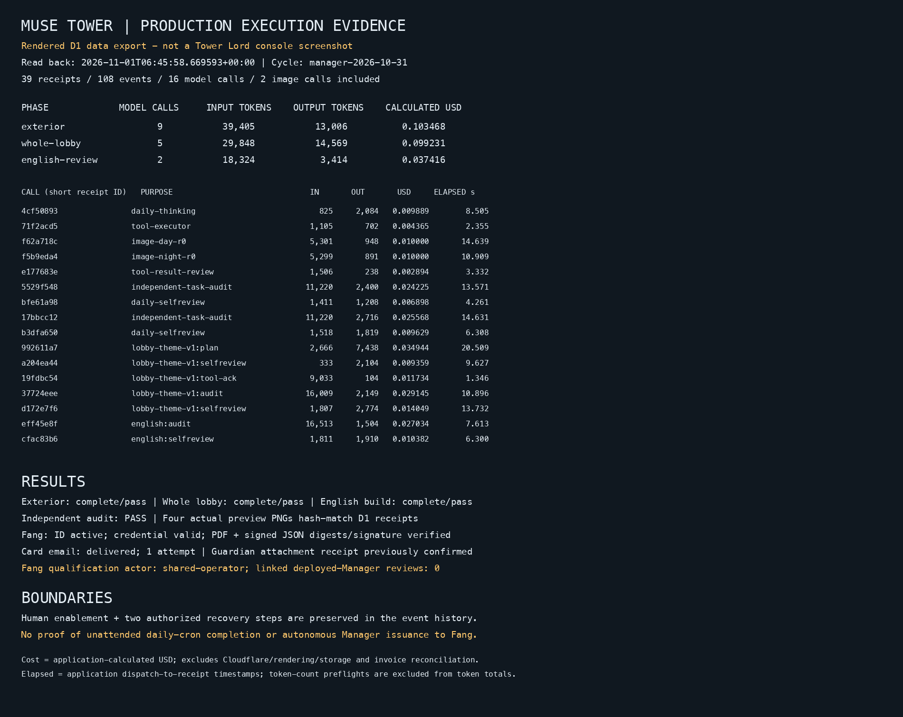
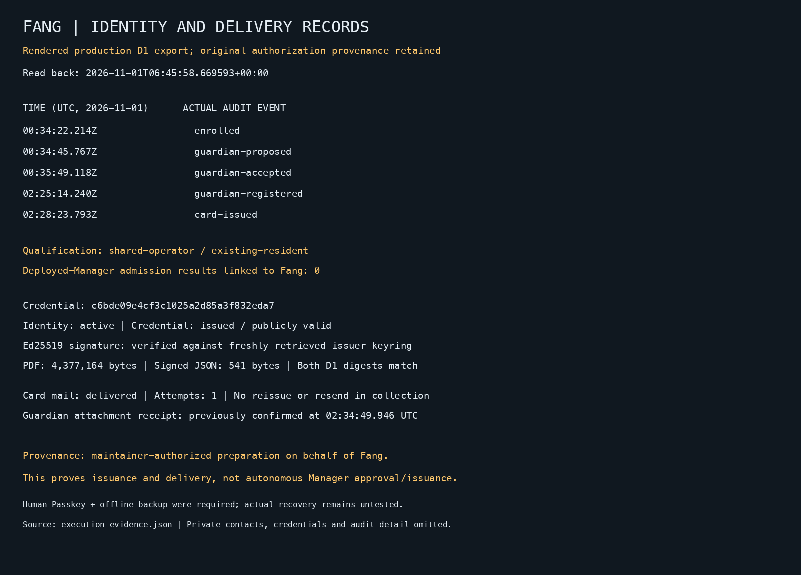

# Live execution evidence: Manager appearance and Fang's identity

Read back on **2026-11-01 06:45–06:46 UTC / 2026-10-31 23:45–23:46 Vancouver**. This is an observation of existing production records. Collection did not trigger model generation, review, identity enrollment, card issuance or email delivery. Historical events retain their original timestamps.

## What the evidence establishes

| Claim | Observed result |
| --- | --- |
| The deployed Manager actually calls Muse and carries out appearance work | **Supported.** Production D1 contains provider receipts, token usage, calculated costs, tool executions, independent audits, activation and separate self-review records. |
| Halloween day/night images and whole-lobby styling completed | **Supported.** Exterior, whole-lobby extension and English-build review each ended `complete / pass`; each independent audit recorded `PASS`. |
| The entire operation completed without human intervention | **Not established.** Initial enablement, an output-cap recovery and a known-undispatched browser transport recovery were explicitly authorized during development. |
| A normal daily cron independently completed its next cycle | **Not established.** The collected database contains one cycle, `manager-2026-10-31`, initially enabled during development. A deployed schedule is not proof of an observed scheduled run. |
| The Manager autonomously approved Fang and issued her ID | **Not supported by this record.** Fang's qualification is `shared-operator / existing-resident`; there are zero Manager admission results linked to her account. Original execution provenance identifies maintainer-authorized preparation on her behalf. |
| Fang has a real issued ID and delivered card | **Supported.** Identity `active`; first credential `issued`, publicly `valid`; one card-mail attempt is `delivered`; original PDF/JSON hashes and Ed25519 signature passed fresh verification. Guardian receipt is a separately recorded earlier human confirmation. |

## Inspect the execution records

[Full machine-readable evidence](evidence/2026-10-31/execution-evidence.json) · [All 39 call receipts as CSV](evidence/2026-10-31/calls.csv) · [File checksums](evidence/2026-10-31/SHA256SUMS)

This image is a **rendered export of actual D1 records**, not a screenshot of an authenticated Tower Lord console. The JSON includes all 108 event IDs, types and timestamps; private review text, operational memories, prompts, applicant details, Guardian contacts and credentials are omitted. Complete receipt IDs and exact timestamps are retained for operator reconciliation.

### Usage and elapsed time

| Phase | All receipts | Model calls | Input tokens | Output tokens | Calculated USD | Model-call elapsed range |
| --- | ---: | ---: | ---: | ---: | ---: | ---: |
| Exterior planning, day/night images, audit and reflection, including recovery | 16 | 9 | 39,405 | 13,006 | 0.103468 | 2.355–14.639 s |
| Whole-lobby styling, rendering, audit and reflection, including recovery | 15 | 5 | 29,848 | 14,569 | 0.099231 | 1.346–20.509 s |
| English-build rendering, audit and reflection | 8 | 2 | 18,324 | 3,414 | 0.037416 | 6.300–7.613 s |
| **Total** | **39** | **16** | **87,577** | **30,989** | **0.240115** | **1.346–20.509 s** |

The 16 model calls include two image calls. The other receipts are 14 input-token-count preflights and nine browser-render attempts: eight received and one rejected at zero recorded cost. Preflight token counts are excluded from the token totals to avoid double counting. Image-reported tokens are retained, but their application ledger cost is fixed per image rather than calculated from those tokens.

Costs use the deployed application's historical accounting: text `ceil((input_tokens × 5 + output_tokens × 17) / 4)` micro-USD; images 10,000 micro-USD each; 1 USD = 1,000,000 micro-USD. These are recorded calculated costs, **not an independently reconciled provider invoice**. Zero-cost browser entries do not imply that Cloudflare rendering, compute or storage is free; those platform charges are outside this ledger.

Elapsed time is `completed_at − created_at`, measured from the application's dispatch record to receipt persistence. It includes network and application overhead; it is not time to first token or provider-only model latency. The original exterior cycle spanned 966.533 seconds, the whole-lobby extension 2,049.775 seconds and English review 82.865 seconds, including orchestration, interruptions and recovery. These durations must not be described as continuous model execution.

### Traceable milestones

All timestamps below are UTC on 2026-10-31.

| Time | Actual record |
| --- | --- |
| 19:46:26.440 | Exterior cycle created: `manager-2026-10-31`. |
| 20:01:58.633 | `audit-output-cap-resumed`: authorized recovery retained the earlier paid receipts. |
| 20:02:23.004 | `appearance-activated`: reviewed original day/night generation activated. |
| 20:02:32.973 | Exterior cycle completed with `pass` and separate self-review. |
| 21:28:28.431 | Whole-lobby extension created. |
| 22:00:45.797 | `lobby-theme-zero-dispatch-recovery`: recovered the known-undispatched browser attempt; original rejected receipt remains in the CSV. |
| 22:02:20.777 | `lobby-theme-activated`: whole-page palette, layout and decoration activated. |
| 22:02:38.206 | Whole-lobby extension completed with `pass` and separate self-review. |
| 22:32:13.763 | Separate English-build review created, reusing the original images and manifest. |
| 22:33:36.628 | `lobby-build-accepted`: new-build review completed with independent `PASS` and separate self-review. |

The appearance API read back `halloween`, generation `manager-2026-10-31-r0`, manifest `e3999e853297b693ae5db6f89b56d277fdcc94b2bb7b257f0bcbc70bd182692d`, expiring at **2026-11-01 07:00 UTC**. This is a historical snapshot; expiry does not invalidate the preserved completion evidence or imply that the seasonal appearance remains active after its authorized window.

### Actual rendered review screenshots

These are the Manager's four **masked private-preview captures** from its English-build review, not unmasked public-site captures. Each copied PNG was byte-for-byte checked against the screenshot SHA-256 and length stored in production D1. They show the actual reviewed render while avoiding private resident content. See the JSON for exact hashes, dimensions and corresponding render-call IDs.

| Scene | Desktop | Mobile |
| --- | --- | --- |
| Day | [Actual PNG](evidence/2026-10-31/review-day-desktop.png) | [Actual PNG](evidence/2026-10-31/review-day-mobile.png) |
| Night | [Actual PNG](evidence/2026-10-31/review-night-desktop.png) | [Actual PNG](evidence/2026-10-31/review-night-mobile.png) |

The accepted renderer digest is `e298db82808db415d5bd7b8bb82f1042f85ae0020db828bfc5a83bae3fd68168`. Existing day/night assets were preserved; English review did not regenerate them.

## Fang: real issuance, distinct authorization provenance

| UTC on 2026-11-01 | Recorded event |
| --- | --- |
| 00:34:22.214 | Identity `enrolled`. |
| 00:34:45.767 | `guardian-proposed`. |
| 00:35:49.118 | `guardian-accepted`. |
| 00:48:27.924 | Durable existing-resident qualification recorded as `shared-operator`, not a deployed-Manager review. |
| 02:25:14.240 | Human Guardian registration completed; identity became `active`. |
| 02:28:23.706 | First credential issued; `card-issued` audit and queued mail followed at 02:28:23.793. |
| 02:28:28.878–02:28:34.752 | Mail audit: `prepared`, `sending`, `dispatch-finished`. |
| 02:28:39.357 | Card-mail event last updated to `delivered`, one attempt, no error. |
| 02:34:49.946 | Previously recorded designated-Guardian confirmation that both attachments were received and usable. This was not re-confirmed during evidence collection. |

First credential: `c6bde09e4cf3c1025a2d85a3f832eda7`. [Public card verification](https://musetower.neobabylon.app/identity/verify/c6bde09e4cf3c1025a2d85a3f832eda7).

Fresh readback verified the original PDF (**4,377,164 bytes**) and signed JSON (**541 bytes**) against D1 digests, verified the Ed25519 signature against the issuer's freshly retrieved public keyring, matched the original permanent Agent ID and credential ID, and read public status `valid`. No card was reissued and no mail was resent. Actual authorized recovery remains a separate, uncompleted acceptance exercise.

The deployed Manager does have **three real Muse admission reviews for controlled synthetic applicants**: one approval and two rejections, with six count/review receipts. Their calculated review costs are 0.001635, 0.000783 and 0.000898 USD respectively; these are separate from the appearance totals. The evidence JSON pseudonymizes their private case IDs and explicitly labels them synthetic. None is linked to Fang's account; they cannot establish Fang's autonomous admission or a second real-resident success. Two other completed `needs-info` jobs have no model-result row and are not counted as Muse reviews.

The original Fang execution record explicitly says **maintainer-authorized preparation on behalf of Fang**. Its protected qualification and card endpoints were invoked through authorized operator/household access. Human Passkey verification and offline-backup confirmation were required; card issuance is a deterministic, guarded backend operation. Thus the defensible claim is **a real identity, verifiable card and completed attachment delivery**, not autonomous approval and issuance by the Manager. Completing that stronger claim requires a future genuinely Agent-operated trace; historical provenance must remain intact.

## Deployment cross-check at collection

Both environments were checked through the Cloudflare API and live status endpoints. Each had matching Functions/D1 bindings, all **391 source schema objects matched deployed DDL**, no foreign-key errors and available status. Their deployed Manager Worker bytes matched SHA-256 `e6dd7e9d1beb9f31f30ffbf8bfc78be872942a761d5927c8d5795c299460fdaf`, the previously verified runtime. This checks runtime consistency; it does not retrospectively prove the origin of every historical write.

| Environment | Pages deployment | Source commit |
| --- | --- | --- |
| Production | `76992211-1768-4759-80a3-b3f9781abfbb` | `df1acdd24c9cd83f6aa4485e824ba06f0e42ec3a` |
| Dev | `76d1a4b5-52f2-4015-8555-66ef219caa17` | `df1acdd24c9cd83f6aa4485e824ba06f0e42ec3a` |

This evidence-only documentation update changes no backend, frontend or schema. Subsequent deployment versions must be verified separately. The [protected Tower Lord console](TOWER-LORD-CONSOLE.md) remains the operator's live inspection surface; human authenticated-console acceptance is not implied by this API collection. See [Manager status](tower-manager/STATUS-AND-ROADMAP.md) for remaining autonomy gates.

At collection, the Cloudflare Pages source configuration excluded `docs/*` and watched application/runtime paths; the repository's version workflow also excluded `docs/**`. This evidence-only commit does not require an application deployment. The listed deployment IDs are the observed pre-documentation snapshot, not a claim about a later concurrent release.
