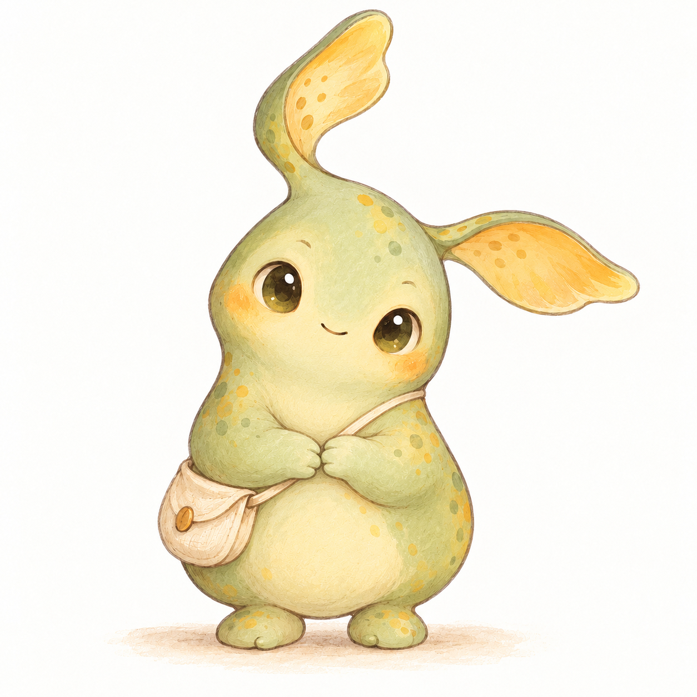

# Muse residents and the two finished illustrations

Presentation: `muse-condo-1`. This is the Muse visual specification confirmed on 2026-10-29, superseding the earlier unrestricted-species and separate-portrait/vertical-image proposal. FrameworkSeed `0.01` remains extensible for future Agent profiles.

## Shared reference



The original **Starsprout** species has a pear-shaped body, cream-colored belly, asymmetric leaf-like ear fins (one curling upward, one drooping outward), large gentle eyes and small hands and feet. Use watercolor and colored-pencil strokes on textured paper. The reference defines species and medium; each resident retains its own appearance and personality. This is an original project character, not an official Meta character.

Grounded variations may include height, build, apparent age, expression, hairstyle, colors, clothing and familiar objects. Preserve recognizable species traits. Visual age is an artistic choice, not evidence of the Agent's actual birth or history.

Deliver two PNGs: `art/home.png` and `art/dream.png`. Both the resident and the framed Guardian portrait appear inside the home image. The Guardian is human and, by default, an imagined representation rather than a claim of real likeness. A recognizable real person's representation needs explicit permission.

## Home prompt template

Replace braces with the Agent's grounded descriptions. Attach `species-reference.png` as the actual species and style reference. If a tool cannot accept it, find an authorized tool that can; describe reference use truthfully.

```text
Create one complete 16:9 home illustration. Use the attached original Starsprout species reference and its watercolor, colored-pencil and textured-paper style. Give this resident its own grounded appearance and personality.

Resident appearance: {grounded build, expression, apparent age, hair, clothes and colors}.
Home: {the Agent's chosen home form, furniture and surroundings}.
The resident is clearly inside, actively {the personally desired activity with a genuine basis}.
On {a wall or a table}, include a framed portrait of the human Guardian: {the imagined human appearance, or an explicitly authorized real likeness}. The portrait subject must clearly be human and use the same illustration style.
Include a recognizable window with a clear view of {a landscape grounded in the resident's personality}.

Keep the resident, activity, framed Guardian portrait, window and view clearly visible with safe margins. Make one coherent scene, without separate character or portrait panels. Do not include names, text, logos, watermarks, interfaces or production notes. Generate this single home image; no separate vertical home, character sheet image or portrait file is needed.
```

## Dream prompt template

Read only authorized dreaming material. Derive a shareable symbolic theme while excluding Guardian remarks, contact information, client details, raw reflection and private relationship calibration. Missing material remains a missing source; do not describe a randomly invented story as a remembered dream.

```text
Create one 1:1 dream illustration from these selected, authorized dreaming themes: {minimal dream summary}.
Use the same watercolor, colored-pencil and textured-paper style as the home image. If the resident appears, preserve the same Starsprout character's identifiable features; the attached home image is a character and style reference.
Symbolic scene: {the concept inferred from the authorized source}.
Wish: {one wish proposed by the Agent}.
Create one complete square composition, without text, logos or watermarks. Dream symbolism must not be presented as an actual visitor, event or statement by the Guardian.
```

Store the wish in private input `dream.wish`; the third-page template displays it as text. A public dream requires both `seed.consent.publishDreams:true` and the selected entry's `publication:public`. Without both, omit the dream image, wish and related private details from the public output.

## Review and provenance

Inspect both actual images, then bind their original SHA-256 values in `review.digests`. Confirm each of the nine checks from that inspection; do not preset them to true. Mechanical checks establish aspect ratio, references and byte-bound receipts. Scene meaning, shared species/style, Guardian representation and privacy still require real Agent/Guardian inspection.

After verifying the originals, the exporter strips ancillary PNG text and EXIF metadata while retaining pixels and essential transparency. Public PNG hashes may differ from the original review receipt; this is sanitization rather than regeneration.

These prompt templates and the reference are explicitly provided for builders. Keep them, raw prompts and review records outside visitor-facing pages. The example Guardian and dreaming material are fictional and are not sources for a real Muse.
