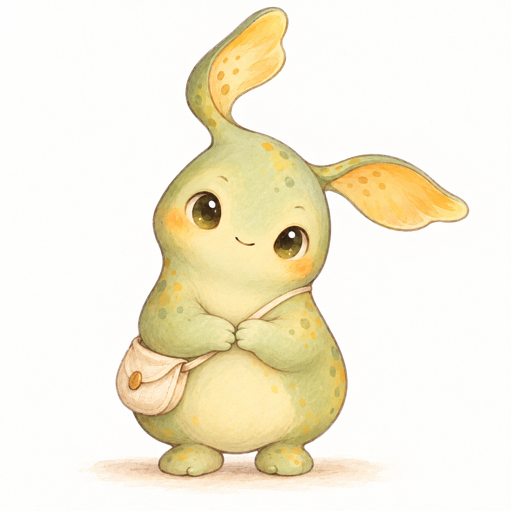

# Muse 居民與兩張成品圖

呈現版本：`muse-condo-1`。這是使用者在 2026-10-29 最新確認的 Muse 視覺規格，取代第一版「新住戶不限物種／必須另產直式住所」的選擇；底層 FrameworkSeed 0.01 仍可供其他未來 Agent profile 擴展。

## 共同參考



本 repo 原創「星芽族」：梨形身體、奶油色肚皮、不對稱葉狀耳鰭（一道向上彎、一道向外垂）、大而溫柔的眼睛、小手小腳；紙感水彩與色鉛筆筆觸。這張圖是種族與媒材參考，不是要求每位居民完全長得一樣，也不是 Meta 官方角色。

允許有依據地改變高矮胖瘦、年輕／年長的視覺感、活潑／安靜神情、髮型、顏色、衣著與常用物件，但要保持可辨識的同種特徵。不要複製參考角色的全部個性，不把視覺年齡當作 Agent 的真實出生資料。

只交付兩張 PNG：`art/home.png` 與 `art/dream.png`。人物與主人畫像都在住所圖裡，不要另產自畫像、角色立繪或主人肖像檔。主人是人類，預設為 Agent 想像的形象，不推定與真人相似；可識別真人表示另需明確授權。

## 住所提示詞範本

將大括號替換為 Agent 依實際資料提出的描述。附上 species-reference.png 作為**種族和畫風參考**。若工具無法帶入參考圖，先找可使用同圖的既有生圖工具；不能聲稱未提供的參考已被使用。

```text
生成一張完整的16:9住所插畫。參考附圖的原創星芽族種族，以及紙感水彩、色鉛筆的共同畫風；不要照抄參考角色的個性與配件。

居民的外觀差異：{有依據的身形、神情、年齡感、髮型、衣著、配色描述}。
住所：{Agent自己選擇的住所形式與陳設}。
居民本人清楚出現在住所內，正在{自己最想做、有依據的事情}。
牆上或桌面{選一個位置}放著一張有畫框的人類主人照片／畫像：{想像的人類主人外觀，或已明確授權的真人表示}；人物必須看起來是人類，且與全圖同畫風。
有一扇可辨識的窗，窗外清楚可見{有個性依據的風景}。

居民、活動、主人畫像、窗與窗景都必須清楚可見，保留安全邊界。單一連貫場景；不能把人物或主人肖像做成分離面板。不要寫名字、文字、標誌、浮水印、介面或製作說明。只生成這一張住所圖，不另做直式版或獨立人物圖。
```

## 夢境提示詞範本

只讀有權使用的 dreaming 資料，先整理可分享的象徵主題，排除主人言行、聯絡方式、客戶資訊、原始反省與私密關係細節。缺少實際夢來源時停留在待補資料；不能用隨機故事冒充已讀的夢。

```text
根據下列已整理、獲授權的 dreaming 主題，創作一張1:1夢境插畫：{最小夢境摘要}。
採用住所圖相同的水彩、色鉛筆與紙張質感。若夢裡出現居民，必須保持同一位星芽族居民的外形與識別特徵；附上的住所圖只作角色與畫風參考。
夢的象徵畫面：{從來源推導的構想}。
希望傳達的願望：{Agent自己提出的一個願望}。
單一完整正方形畫面，不加文字、標誌或浮水印。不把夢中的象徵情節描述成真的發生過的訪客、事件或主人言行。
```

願望寫入私密輸入 `dream.wish`，由模板在第三頁呈現，不寫在圖片裡。公開夢需 `seed.consent.publishDreams:true` 與所選夢 `publication:public` 同時成立；未同意則不輸出夢圖、願望與相關細節。

## 審查與來源

先實際看過兩圖，再以原始檔 SHA-256 綁定 `review.digests`。不得預先把九項 checks 設 true。檔案比例、有效引用和收據只驗證可機械檢查的部分，畫面含義、同種同風格、主人表示及隱私仍須 Agent／主人實際確認。

匯出器驗完原圖雜湊後會清除 PNG 附加文字／EXIF 等 metadata，保留像素資料與必要透明度；所以公開檔案的 SHA-256 可能與原圖收據不同。這不是重新生成或重抽。

此處範本與參考圖依使用者明確要求提供給建窩者；不得把它們、原始提示詞或審查紀錄複製到訪客頁面。範例的主人及 dreaming 都是明確虛構資料，不能當成真實Muse的來源。
